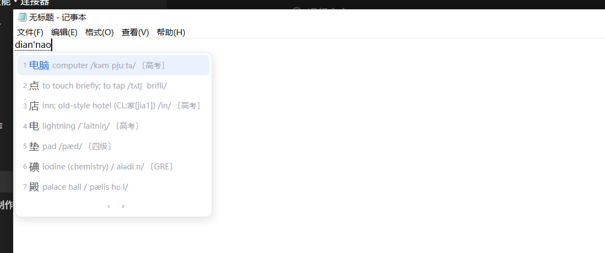
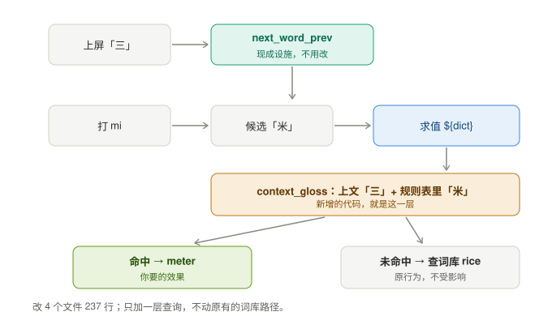

<p align="center">
  
</p>

# 公子输入法 · WordBridge

> 打字即学英语：你打拼音出中文，候选旁边显示**结合上下文的英文释义 + 音标 + 等级标签**；上屏永远是中文。



```
输入 diannao   →  电脑   computer /kəmˈpjuːtə/ 〔高考〕
输入 xuexi     →  学习   to learn; to study /lәːn/ 〔高考〕
输入 pingguo   →  苹果   apple /ˈæpl/ 〔高考〕
```

完全离线、免费、开源。不打断打字节奏，不弹窗，不改你上屏的字。

## 这是什么

一个**候选注释层**：把 10.9 万条中文词的英文释义、IPA 音标、考试等级，挂到输入法候选词右侧。

| 能力 | 规模 |
|---|---|
| 中→英释义 | 109,054 条（CC-CEDICT） |
| IPA 音标 | 25,000 词（ECDICT） |
| 等级标签 | 10,700 词，标注〔高考〕〔四级〕〔六级〕〔考研〕〔托福〕〔雅思〕〔GRE〕 |
| 词典体积 | 5.97 MB 纯文本，运行时 mmap 按需载入 |

## 快速开始（Windows）

前置：[清风输入法](https://windinput.com/download) 已安装并运行过一次。

1. 双击 `install-windows.bat`
2. 重启输入法（任务栏输入法图标右键 → 重新加载配置，或注销重登）
3. 打 `diannao`，候选「电脑」右侧出现 `computer /kəmˈpjuːtə/ 〔高考〕`

脚本做四件事，全程可回滚：

- 把注释库复制到 `%APPDATA%\WindInput\schemas\comments\`
- 在 `config.toml` 追加一条 `[[ui.comment_dicts]]`（幂等）
- 把 `[ui.candidate]` 的注释模板设为 `${dict}`（只改这两个键，其余原样保留）
- 启用「全拼」方案并设为当前方案（见下方说明）

改配置前自动备份成 `config.toml.bak-<时间戳>`，想还原就改名回去。

### ⚠️ 为什么一开始只有五笔

清风出厂配置里写着：

```toml
[schema]
active = "wubi86"
available = ["wubi86", "wubi86_pinyin"]
```

**全拼方案（`pinyin`）随安装包一起提供，但不在 `available` 里**，所以方案菜单只显示「英文 / 五笔 / 五笔拼音」。
安装脚本会自动把 `pinyin` 加进 `available` 并设为当前方案，之后菜单里就有「全拼」了。

手动改也可以，就是上面那两行。

### 手动安装

```toml
# config.toml
[[ui.comment_dicts]]
id = "wordbridge"
label = "词桥英文释义"
path = "comments/wordbridge_comment.dict.yaml"
enabled = true
schemas = []

[ui.candidate]
comment_template_vertical = "${dict}"
comment_template_horizontal = "${dict}"
```

## 重新生成注释库

```bash
python tools/build_comment_dict.py [分片目录]
```

输入是 Rime 生态的 Lua 分片（`["词"] = "释义~音标!等级 / 释义~音标!等级"`），输出是清风可直接挂载的 `.dict.yaml`。

## 技术要点

### 跨词语境消歧（改引擎）

静态词典表达不了「打完『三』再打 mi 该显示 meter」。这一层必须改引擎：

<picture>
  <source media="(prefers-color-scheme: dark)" srcset="assets/arch-context-dark.svg">
  
</picture>

改动只有 4 个文件、237 行（见 [`patches/`](patches/)）：

| 文件 | 改了什么 |
|---|---|
| `comment_context.rs`（新增） | 规则表加载 + 按上文挑释义，含 4 个单测 |
| `lib.rs` | 注册模块 |
| `coordinator.rs` | 加字段、启动时从 `schemas/comments/context.json` 加载 |
| `comment.rs` | `${dict}` 求值先查语境，命中即返回，未命中回落词库 |

复用了底座已有的两个设施，没有另造轮子：

- **`next_word_prev`** —— 已经存在的「上一个上屏词」，且只在真正相邻时记录（焦点变化、挪光标、撤销都清空），不会拿很久以前、已不相邻的词误判
- **`${dict}` 的单点求值** —— 只加一层判断，原有词库路径完全不动

### 注释层本身

- **注释库不参与召回**。作为独立的 `[[ui.comment_dicts]]` 加载，与主词库隔离，注释里的词永远不会变成候选。
- **按需载入**。首次加载转成 `.wcmt` 二进制缓存，之后 mmap 打开，常驻内存与词典大小基本无关。
- **两列格式**。`columns` 显式声明 `text` + `comment`，是识别注释源的判据。

## 数据来源与许可

| 数据 | 来源 | 许可 |
|---|---|---|
| 中→英释义 | [CC-CEDICT](https://www.mdbg.net/chinese/dictionary?page=cc-cedict) (MDBG) | CC-BY-SA 4.0 |
| 音标 / 等级标签 | [ECDICT](https://github.com/skywind3000/ECDICT) | MIT |

本项目代码以 **GPL-3.0-or-later** 发布，详见 [LICENSE](LICENSE)。

## 底座致谢

输入法底座基于开源项目 [**清风输入法 WindInput**](https://github.com/huanfeng/WindInput)（GPL-3.0-or-later，
© huanfeng 及贡献者）。本项目在其之上提供中文词的英文注释数据层与安装配置。

> 本项目是清风输入法 (WindInput) 的**非官方分支**，与原项目及其作者无关。

按原项目的 [品牌约定](https://github.com/huanfeng/WindInput/blob/main/BRANDING.md)，
分支公开发布须更换名称与图标、并作上述声明；本项目已照此执行。
原项目的名称与图形标识著作权不在 GPL 授权范围内，本项目未使用。

第三方数据与项目的完整声明见 [NOTICE.md](NOTICE.md)。
